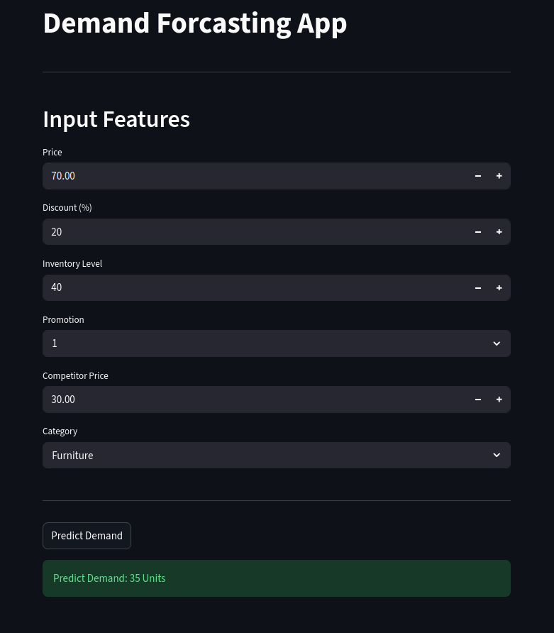
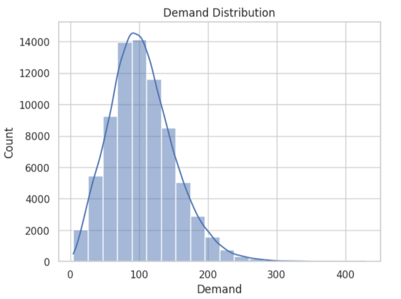
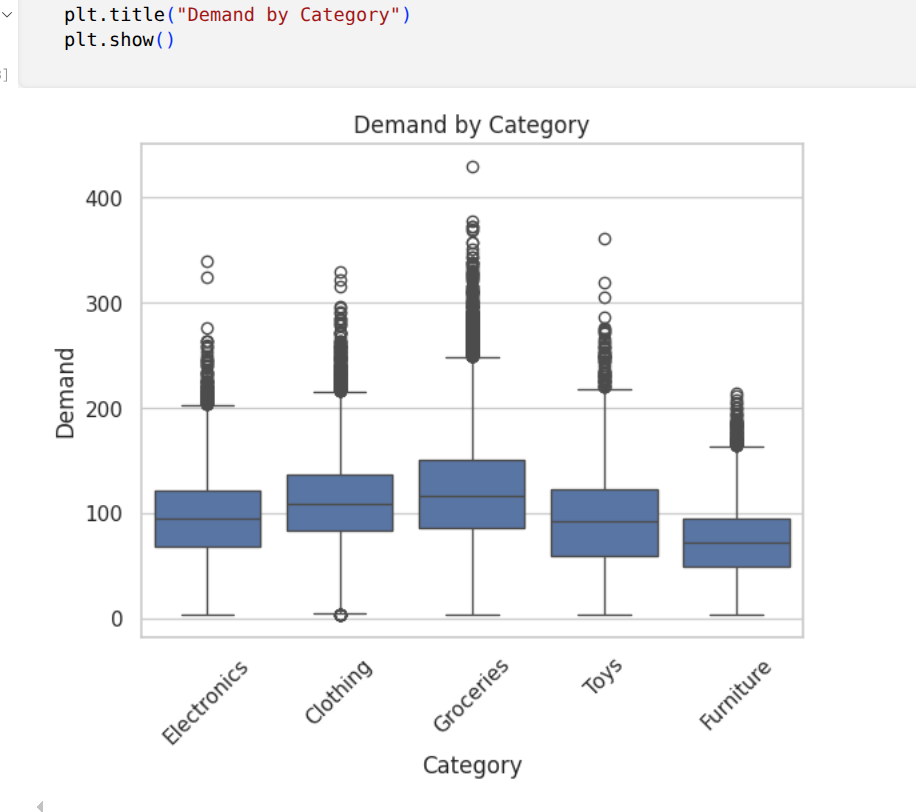
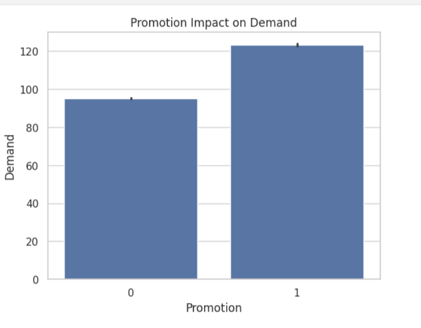
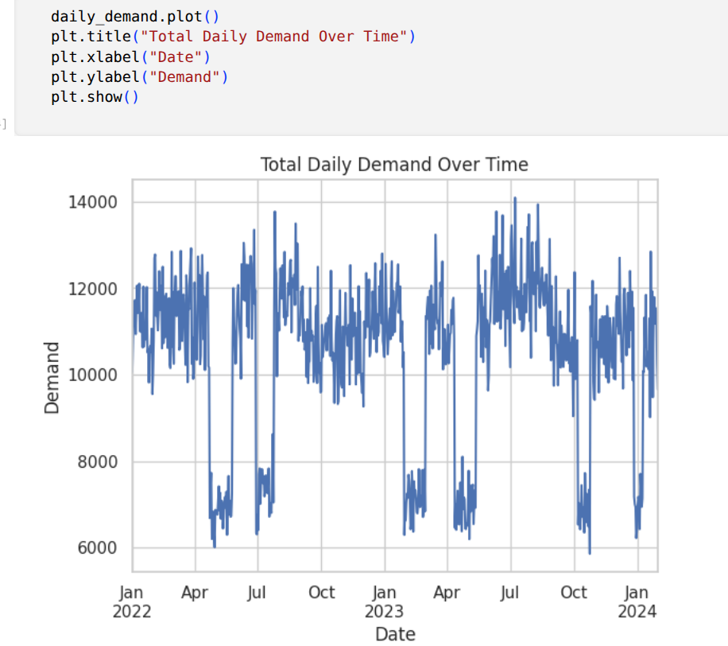

# Demand Forecasting Using XGBoost

An end-to-end machine learning project for retail demand prediction using Python, XGBoost, and Streamlit. The project includes exploratory data analysis (EDA), data preprocessing, model training, hyperparameter tuning, model evaluation, feature importance analysis, and an interactive dashboard for demand prediction.

## Project Overview

Accurate demand estimation can help retailers understand purchasing patterns, evaluate promotional activities, and make better-informed inventory decisions.

This project develops an XGBoost regression model to predict retail demand using product pricing, discounts, inventory levels, promotion status, competitor pricing, and product categories.

An interactive Streamlit application allows users to enter these features and obtain a demand prediction through a simple web interface.

The project demonstrates an end-to-end machine learning workflow, from data exploration and model development to an interactive application.

## Project Objectives

- Perform exploratory data analysis (EDA) to understand retail demand patterns.
- Investigate relationships between demand and product, pricing, promotional, and seasonal factors.
- Preprocess the dataset for machine learning.
- Develop an XGBoost regression model for demand prediction.
- Tune model hyperparameters using `RandomizedSearchCV`.
- Evaluate model performance using MAE, MSE, RMSE, and R².
- Analyze feature importance to understand which features the trained model relies on.
- Develop an interactive Streamlit dashboard for demand prediction.
- Identify opportunities to extend the project into time-series forecasting and inventory optimization.

## Application Preview

The Streamlit dashboard accepts product and pricing information and displays the model's predicted demand.



## Dataset

The dataset contains **76,000 records and 16 original columns**.

### Original Features

| Feature | Description |
|---|---|
| Date | Date associated with the observation |
| Store ID | Store identifier |
| Product ID | Product identifier |
| Category | Product category |
| Region | Geographical region |
| Inventory Level | Recorded inventory level |
| Units Sold | Number of units sold |
| Units Ordered | Number of units ordered |
| Price | Product price |
| Discount | Discount applied |
| Weather Condition | Recorded weather condition |
| Promotion | Promotion indicator |
| Competitor Pricing | Competitor's product price |
| Seasonality | Seasonal classification |
| Epidemic | Indicator for epidemic-related conditions |
| Demand | Target variable for prediction |

**Target variable:** `Demand`

Additional features, including `Year`, `Month`, `Day`, `weekday`, `Discounted_Price`, and `Sell_Through_Rate`, were created during data preprocessing and exploratory analysis.

The current prediction model uses a selected subset of the available features.

**Dataset source:** Add the original dataset's name, source URL, and licence information here before publishing.

If redistribution is not permitted by the dataset licence, provide instructions for obtaining the dataset instead of uploading the original file.

## Exploratory Data Analysis (EDA)

EDA was performed to understand demand distributions and investigate relationships between demand and relevant retail variables.

The analysis included:

- Demand distribution and variability.
- Demand differences across product categories.
- Inventory levels and units sold.
- Demand across weather conditions.
- Monthly and daily demand patterns.
- Promotion and demand relationships.
- Discounted price and demand relationships.
- Demand across seasonal categories.
- Differences between epidemic and non-epidemic observations.

### Key Findings

**1. Demand Distribution**

The demand distribution is right-skewed, with most observations concentrated in the lower-to-middle demand range and a smaller number of high-demand observations.



**2. Demand by Product Category**

Demand distributions differ across product categories. Groceries shows a higher median demand than Furniture in the analyzed dataset.



**3. Promotion and Demand**

Average demand is higher among observations with active promotions than among observations without promotions.

This suggests that promotion status may be useful for demand prediction. However, the observed relationship does not establish that promotions alone cause higher demand.



**4. Daily Demand Patterns**

Total daily demand fluctuates over the observed period. These variations motivate further investigation of temporal patterns and time-aware forecasting techniques.



These findings informed the initial feature selection and model development process. They are descriptive observations and should not be interpreted as proof of causal relationships.

## Technologies Used

| Technology | Purpose |
|---|---|
| Python | Programming and model development |
| Pandas | Data manipulation and preprocessing |
| NumPy | Numerical computations |
| Matplotlib | Data visualization |
| Seaborn | Exploratory data visualization |
| Scikit-learn | Preprocessing, hyperparameter tuning, and evaluation |
| XGBoost | Regression model |
| Streamlit | Interactive web application |
| Jupyter Notebook | Data analysis and experimentation |
| Git and GitHub | Version control and project hosting |

## Machine Learning Workflow

The project follows these steps:

1. **Data loading:** Load the retail dataset into a Pandas DataFrame.
2. **Data inspection:** Examine the dataset structure, data types, missing values, duplicates, and descriptive statistics.
3. **Exploratory data analysis:** Investigate demand distributions and relationships between variables.
4. **Feature engineering:** Create additional date-related and pricing features during preprocessing.
5. **Feature selection:** Select the input variables used by the prediction model.
6. **Categorical encoding:** Encode the product category using the same method used during model training.
7. **Model development:** Train an XGBoost regression model.
8. **Hyperparameter tuning:** Search for suitable hyperparameters using `RandomizedSearchCV`.
9. **Model evaluation:** Calculate MAE, MSE, RMSE, and R².
10. **Feature importance analysis:** Examine the relative importance scores of the model's input features.
11. **Model persistence:** Save the trained model and fitted categorical encoder.
12. **Application development:** Integrate the saved artifacts into a Streamlit dashboard.

## Model Development

### Selected Features

The current XGBoost model uses six input features:

| Feature | Description |
|---|---|
| `Price` | Product price |
| `Discount` | Discount applied |
| `Inventory Level` | Recorded inventory level |
| `Promotion` | Promotion indicator |
| `Competitor Pricing` | Competitor's product price |
| `Category` | Product category |

**Target variable:** `Demand`

Although the dataset contains additional variables, the current model uses only these six features.

### Algorithm: XGBoost Regression

XGBoost was selected because it is a gradient-boosting algorithm that can model nonlinear relationships and interactions between input features.

The model was trained to estimate demand from the selected product, pricing, inventory, and promotion features.

### Hyperparameter Tuning

`RandomizedSearchCV` was used to explore combinations of XGBoost hyperparameters.

The reported experiment used the following settings:

| Parameter | Value |
|---|---|
| Number of sampled configurations (`n_iter`) | 25 |
| Cross-validation folds (`cv`) | 3 |
| Scoring metric | Negative mean absolute error |
| Parallel processing (`n_jobs`) | -1 |

The search included the following hyperparameters:

- `n_estimators`
- `max_depth`
- `learning_rate`
- `subsample`
- `colsample_bytree`
- `min_child_weight`

The objective was to identify hyperparameters that reduce the cross-validation MAE.

For a rigorous future forecasting assessment, the validation procedure should respect chronological ordering and prevent future information from entering the training process.

## Model Evaluation

The latest reported experiment produced the following results:

| Evaluation Metric | Result |
|---|---:|
| Mean Absolute Error (MAE) | 27.14 |
| Mean Squared Error (MSE) | 1,287.14 |
| Root Mean Squared Error (RMSE) | 35.88 |
| R² Score | 0.4195 |

### Interpretation

**Mean Absolute Error (MAE): 27.14**

The average absolute difference between actual and predicted demand was approximately 27.14 units on the evaluated observations.

**Mean Squared Error (MSE): 1,287.14**

The mean squared prediction error was 1,287.14 demand-units squared. This metric penalizes larger errors more heavily.

**Root Mean Squared Error (RMSE): 35.88**

The root mean squared prediction error was approximately 35.88 units.

**R² Score: 0.4195**

The model's R² score was approximately 0.4195, indicating that it explained about 41.95% of the variation in the evaluated target values relative to a mean-prediction baseline.

These results provide an initial assessment of the model's predictive performance. They do not, by themselves, establish how accurately the model forecasts future demand.

The final forecasting assessment should use a chronological holdout period containing observations later than those used for training and model selection.

## Feature Importance Analysis

Feature importance was extracted from the trained XGBoost model and visualized using a bar chart.

In the latest reported feature importance visualization, the features were ranked approximately as follows:

1. **Promotion**
2. **Category**
3. **Price**
4. **Competitor Pricing**
5. **Discount**
6. **Inventory Level**

Promotion and Category received the highest importance scores in that experiment.

This indicates that the fitted model relied more heavily on these features when making predictions.

Feature importance is model-dependent. It does not establish causation, and the ranking may change with the training data, feature representation, and selected hyperparameters.

## Interactive Streamlit Dashboard

The project includes an interactive Streamlit application that connects the trained XGBoost model to a user-friendly interface.

### Dashboard Inputs

Users can enter:

- Price
- Discount percentage
- Inventory level
- Promotion status
- Competitor price
- Product category

After clicking **Predict Demand**, the application displays the estimated demand in units.

### Example

For a selected combination of product and pricing features, the application returns a predicted demand value.

The prediction is an estimate from the trained model, not a guarantee of actual future demand or an inventory replenishment recommendation.

### Running the Application

#### 1. Clone the repository

```bash
git clone <YOUR_GITHUB_REPOSITORY_URL>
cd retail-demand-prediction-xgboost
```

Replace `<YOUR_GITHUB_REPOSITORY_URL>` with the URL of your GitHub repository.

#### 2. Create a virtual environment

```bash
python -m venv .venv
```

Activate the environment on Ubuntu or other Linux systems:

```bash
source .venv/bin/activate
```

#### 3. Install dependencies

```bash
python -m pip install -r requirements.txt
```

#### 4. Prepare the model files

The application requires the saved XGBoost model and the fitted label encoder:

- `xgboost_demand_model.pkl`
- `label_encoders.pkl`

Place these files in the locations expected by `app.py`.

If the model files are not included in the repository, follow the model-training notebook or the project's model setup instructions to generate them.

**Security note:** Only load pickle files from trusted sources.

#### 5. Run the Streamlit application

If the application is stored in `app/app.py`, run:

```bash
python -m streamlit run app/app.py
```

If `app.py` is stored in the repository root, run:

```bash
python -m streamlit run app.py
```

Streamlit will display a local URL, typically:

```text
http://localhost:8501
```

Open the address in your browser to access the dashboard.

## Repository Structure

The repository can be organized as follows:

```text
retail-demand-prediction-xgboost/
│
├── README.md
├── requirements.txt
├── .gitignore
│
├── notebooks/
│   ├── Demand_Forcasting.ipynb
│   └── Forcasting_ML.ipynb
│
├── app/
│   └── app.py
│
├── models/
│   └── README.md
│
├── screenshots/
│   ├── streamlit_dashboard.png
│   ├── demand_distribution.png
│   ├── demand_by_category.png
│   ├── promotion_impact.png
│   └── daily_demand_over_time.png
│
└── data/
    └── README.md
```

Adjust the directory structure and filenames to match the files actually included in your repository.

## Limitations

- The current model uses six input features.
- Historical demand lags and rolling averages are not explicitly included in the current model.
- The reported evaluation metrics do not establish performance on future dates.
- The feature importance scores describe the fitted model and do not establish causal relationships.
- The current dashboard predicts demand from user-provided inputs rather than generating a validated multi-day forecast.
- Inventory optimization and automatic replenishment recommendations have not yet been implemented.

## Future Improvements

Potential extensions include:

- Use chronological train-test splitting and time-aware cross-validation.
- Add historical demand features, such as lagged demand and rolling averages.
- Evaluate performance on unseen future dates.
- Compare XGBoost with simple forecasting baselines and other suitable forecasting models.
- Investigate demand patterns for individual stores and products.
- Develop forecasts for multiple horizons, such as 7-day and 30-day demand.
- Improve dashboard visualizations and prediction explanations.
- Extend the application to support inventory optimization and replenishment planning.
- Deploy the Streamlit application for public access.

## Conclusion

This project demonstrates an end-to-end machine learning workflow for retail demand prediction, combining exploratory data analysis, preprocessing, XGBoost regression, hyperparameter tuning, model evaluation, feature importance analysis, and an interactive Streamlit dashboard.

It provides a foundation for further work in retail analytics, time-series forecasting, and inventory optimization.

## Author

**Rajat Kumar**

Mathematics | Data Science | Artificial Intelligence

- GitHub: <https://github.com/rajatiiser>
- LinkedIn: www.linkedin.com/in/rajat-kumar-06909454
